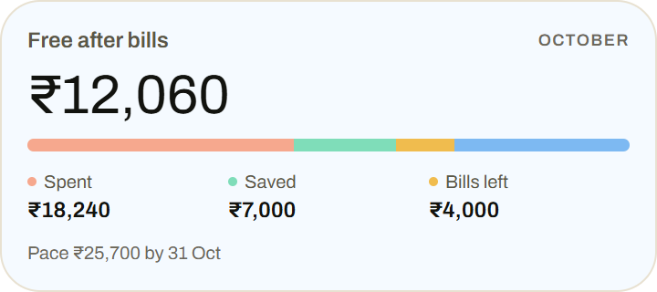
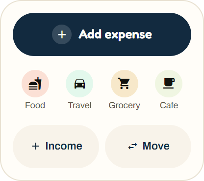

<div align="center">
  
  <h1>Yume · 夢</h1>
  <p><strong>Better money. Bigger dreams.</strong></p>
  <p>A calm, local-first money tracker for Android.<br />Track today, plan ahead, and see where your money goes.</p>
  <p>
    
    
    
    
  </p>
  <p>
    <a href="#what-yume-does">Features</a> ·
    <a href="#privacy--backups">Privacy</a> ·
    <a href="#run-locally">Get started</a> ·
    <a href="#build-an-apk">Build APK</a> ·
    <a href="#documentation">Documentation</a>
  </p>
</div>

---

## What Yume does

Yume brings everyday spending, future payments and longer-term goals together. Its pastel themes,
translucent cards and compact overviews keep the information approachable, with rupee formatting
and India-friendly dates.

| Screen       | What you can do                                                                                                                                               |
| ------------ | ------------------------------------------------------------------------------------------------------------------------------------------------------------- |
| **Home**     | Review free-to-use money, today's spending allowance, interactive spending bars, account balances, the largest upcoming outgoings and five recent entries.    |
| **Activity** | Browse entries by day, switch periods, search words or amounts, filter transactions and open entry details.                                                   |
| **Add**      | Record expenses, income, transfers and friend entries with a calculator pad, usual entries, reusable labels, splits, staged entries and local draft recovery. |
| **Plan**     | Review a 14-day forecast, budget limits, debt progress, savings goals, people balances, habits and scheduled payments.                                        |
| **Reports**  | Explore daily spending, category or account breakdowns, income, trends, comparisons and custom date ranges.                                                   |

### The details that matter

| Area                      | Included                                                                                                                                          |
| ------------------------- | ------------------------------------------------------------------------------------------------------------------------------------------------- |
| **Accounts & categories** | Bank, cash, credit-card and savings accounts; account currencies; editable parent categories and subcategories.                                   |
| **Loans**                 | EMI schedules and amortization, prepayments, rate changes, payment tracking and linked assets.                                                    |
| **Budgets & goals**       | Monthly limits, rollover, goal contributions, whole-account tracking and shared goal reservations without moving money.                           |
| **Recurring payments**    | Scheduled expenses, income and transfers, subscription suggestions, and monthly/yearly totals.                                                    |
| **Planning insights**     | Pending refunds and partial receipts, reservation-aware purchase checks, annual-bill preparation goals, and matched-period spending explanations. |
| **Friends & family**      | Money owed in either direction, settlement history, and a choice between balance adjustments and actual account movements.                        |
| **Wrap & Suu**            | Weekly/monthly stories, selectable chapters, day and category exploration, replay, share cards and Suu's spending nudges.                         |
| **Personalization**       | Twelve themes, app amount hiding, a separate widget-privacy setting, and app lock using the phone's authentication.                               |
| **Everyday housekeeping** | Needs you alerts, duplicate/starting-balance checks, undoable tidy-up actions and recently deleted entries.                                       |

### Android widgets

Five widgets keep useful shortcuts and summaries on your home screen: **This Month**, **Quick Add**,
**Suu Check-in**, **Next Due** and **Accounts**.

<p align="center">
  
  &nbsp;
  
</p>

Financial widgets have their own **Hide widget details** setting. App Lock alone does not conceal
home-screen widget information. Quick Add remains available when widget details are hidden.

## Privacy & backups

Your financial records live in an **on-device SQLite database**. Yume does not require an app
account or a hosted backend to track your money.

- **Local backups:** save a copy yourself or choose an Android folder for automatic backups while
  Yume is open.
- **Existing folder data:** backup files are inspected before newer or different data is replaced;
  choosing a folder can offer a restore preview.
- **Restore preview:** review the backup's contents and the current data before replacing it.
- **Recovery:** a safety copy is retained before a restore, with an option to put it back.
- **App lock:** use the phone's supported authentication to protect access to the app.
- **Sharing:** backup and report exports go to the destination you choose through Android's sharing UI.

Backups belong to you. Keep a copy outside the app's private storage before uninstalling or clearing
app data. See [Backup & restore](BACKUP.md) for folder selection, restore validation and recovery behavior.

## Run locally

### Requirements

- **Node.js 22.13 or newer**; `.nvmrc` selects Node 22. See the [Expo SDK 57 reference](https://docs.expo.dev/versions/v57.0.0/).
- npm and the dependencies in the committed lockfile.
- An Android development environment and an emulator or connected Android phone for local native builds.

```bash
git clone https://github.com/hemuush/yume.git
cd yume
npm ci
npx expo run:android
```

The last command builds and installs the development app and starts Metro. Once that development
build is installed, start the normal development session with:

```bash
npm start
```

> **Use a native development build.** Yume depends on native integrations, including Android
> widgets and the keyboard controller, that are not available in Expo Go. This repository targets Android.

## Build an APK

The EAS profiles are defined in [eas.json](eas.json). Building through EAS requires an Expo account;
using the installed app does not.

```bash
npm install -g eas-cli
eas login
eas build --platform android --profile preview
```

| Profile      | Output                    | Purpose                                                 |
| ------------ | ------------------------- | ------------------------------------------------------- |
| `preview`    | Installable `.apk`        | Internal/device testing; currently targets `arm64-v8a`. |
| `production` | Android App Bundle `.aab` | A build for Play Store distribution.                    |

Both profiles automatically increment the Android version code. EAS provides a build page and
download link when the build completes. For a production bundle:

```bash
eas build --platform android --profile production
```

See [Build guide](BUILD.md) for additional setup and physical-device checks.

## Development checks

```bash
npm run typecheck
npm run lint
npm run format:check
npm test -- --runInBand
npm run test:security
npx expo export --platform android
```

Use `npm run format` to apply formatting and `npm run test:perf` for the repository's performance
fixtures. CI also runs Expo Doctor and the dependency audit gate.

Tests cover money/date calculations, SQLite queries, backup validation, privacy, component
interactions and screen flows. Release validation also needs a real phone: keyboard behavior,
back gestures, enlarged text, scrolling, app-resume behavior and widgets are device checks.

## Project structure

```text
app/                  Expo Router screens and navigation
  (tabs)/             Home, Activity, Plan, Reports and the Add entry route
src/
  components/         Shared controls, cards, sheets and dialogs
  features/           Screen-specific UI, styles and helpers
  db/                 SQLite schema, queries and transactional mutations
  lib/                Money/date logic, backups, exports, locks and reminders
  constants/          Design tokens and default categories
  theme/              Theme packs and appearance/privacy contexts
  widgets/            Android widgets and their data sources
  test-support/       Real SQLite test harness and native-module mocks
  __tests__/          Cross-cutting checks
assets/               Brand, icons and widget previews
plugins/              Native Expo config plugins
scripts/              Test runner, performance fixtures and audit checks
.github/workflows/    Continuous integration
```

Keep reusable UI in `src/components/`, screen-specific presentation in `src/features/`, database
access in `src/db/` and independent logic in `src/lib/`. Tests usually live beside the code they
exercise. Type checking rejects unused imports, locals and parameters; intentional unused
parameters use an `_` prefix.

When evaluating unused code, include file-based routes, the widget handler in `index.js`, config
plugins and performance fixtures. Native integration can use a dependency without a direct app import.

## Documentation

Start with the [documentation index](docs/INDEX.md) and [architecture and logic guide](docs/ARCHITECTURE.md). Historical reports record earlier revisions; their validation counts are not fresh release results.

| Guide                                                  | Read it for                                                                |
| ------------------------------------------------------ | -------------------------------------------------------------------------- |
| [Data model](DATA_MODEL.md)                            | Schema, accounts, the friends ledger and calculation decisions.            |
| [Backup & restore](BACKUP.md)                          | Local-folder backups, choosing existing data, restore safety and recovery. |
| [Build guide](BUILD.md)                                | APK/AAB builds and device verification.                                    |
| [Audit record](docs/archive/AUDIT.md)                  | Recorded fixes, validation and remaining device checks.                    |
| [Expo SDK 57](https://docs.expo.dev/versions/v57.0.0/) | The versioned Expo reference used by this project.                         |

---

<p align="center"><strong>Small daily decisions. More room for your dreams.</strong></p>
